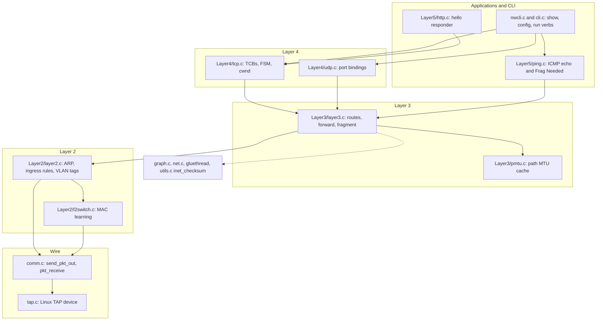

# SamTCPIP

A from-scratch TCP/IP stack in C.

## Layout

```
graph.h / graph.c       generic in-memory graph (Node / Link / Interface)
gluethread/             intrusive doubly-linked list used everywhere
topologies.c            canned topologies for smoke tests
testapp.c               minimal CLI driver for the build
Makefile / build.sh     build wiring
tests/                  bash E2E tests, one per chapter
```

*Diagram: the layered stack and its modules*



## TCP recovery and routing (chapter 44)

SamOS runs this stack in its kernel. What it fixed and added there came
back here: a TCP send buffer with retransmission,
RFC 6298 RTT, fast retransmit, an out-of-order queue and TIME_WAIT; an
IP forwarding switch, Time Exceeded, router ICMP errors, fragmenting on
forward, 64 KiB reassembly and a longest-prefix-match fix; ARP that holds
datagrams until the reply. A timer thread (comm.c) runs the TCP and
reassembly timers every 10 ms. Tests 44 to 50 cover it, with
`run node X drop-tcp <skip> <count>` as the lossy link.

## Build + test

```
./build.sh
bash tests/run-all.sh
```
